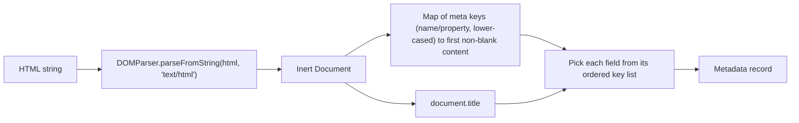

# HTML Metadata Parser Kit

Two small JavaScript functions for link previews, bookmark tools and
search boxes:

- `getMetadata(html)` reads a page's URL, site name, title, description,
  keywords and author from its `<title>` and `<meta>` tags.
- `filterMetadata(records, query)` narrows a list of those records with a
  forgiving, punctuation-insensitive search.

The kit has no runtime dependencies. It relies on the platform's
`DOMParser`, which every browser has; in Node you hand it one from jsdom,
linkedom or happy-dom. The repository started as a coding exercise and keeps
that scope.

## Reading metadata

```js
import { getMetadata } from "html-metadata-parser-kit";

const metadata = getMetadata(`
  <head>
    <title>Field notes &amp; sketches</title>
    <meta name="description" content="">
    <meta property="og:description" content="A sketchbook of birds seen on the coast.">
    <meta property="og:url" content="https://example.com/notes">
    <meta property="og:site_name" content="Example Journal">
    <meta NAME="Keywords" content="birds, coast, sketching, birds">
    <meta name="author" content="A. Writer">
  </head>
`);
```

`metadata` is:

```json
{
  "url": "https://example.com/notes",
  "siteName": "Example Journal",
  "title": "Field notes & sketches",
  "description": "A sketchbook of birds seen on the coast.",
  "keywords": ["birds", "coast", "sketching"],
  "author": "A. Writer"
}
```

Each field comes from the first source in this list that has a non-blank
value:

| Field         | Sources, in priority order                             |
| ------------- | ------------------------------------------------------ |
| `url`         | `og:url`, `url`                                        |
| `siteName`    | `og:site_name`, `site_name`                            |
| `title`       | `<title>`, `og:title`, `twitter:title`                 |
| `description` | `og:description`, `description`, `twitter:description` |
| `keywords`    | `keywords`, split on commas, trimmed and de-duplicated |
| `author`      | `author`                                               |

A meta key matches either the `name` or the `property` attribute, and the
comparison ignores case, so `<META NAME="Keywords">` counts. A tag with an
empty `content` is skipped rather than ending the search, which is why the
blank `description` above does not hide the Open Graph one. Entities are
decoded, whitespace is trimmed, and anything not found is `null`. Input that
is not a string, or is blank, returns all-`null` metadata.

### In Node

Node has no `DOMParser`, so pass one in. jsdom is the usual choice:

```js
import { JSDOM } from "jsdom";
import { getMetadata } from "html-metadata-parser-kit";

const { DOMParser } = new JSDOM().window;
const metadata = getMetadata(html, { DOMParser });
```

Without a browser global or an injected parser, `getMetadata` throws a
`TypeError` that says how to supply one.

## Filtering records

```js
import { filterMetadata } from "html-metadata-parser-kit";

filterMetadata(records, "Sketch-book"); // records mentioning "sketch" or "book"
filterMetadata(records, "harbour boats"); // either word, in any field
filterMetadata(records, ["coast", "dusk"]); // each array entry is one phrase
```

The query and every string field are lower-cased and stripped of
punctuation, including curly quotes, so `N.A.S.A.` finds `nasa.gov` and
`don't` finds `don’t`. Hyphens, underscores and dashes split words, so
`light-year` also matches `light`. A record matches when any query word
appears inside any of its string fields or keywords. A blank query returns
the original array; anything that is not an array returns `[]`.

## How it works



Design notes:

- **Inert parsing.** An earlier version assigned the HTML to `innerHTML` on
  an element of the live page, which lets `` handlers run in a
  browser. `DOMParser` builds a detached document where scripts do not run
  and resources do not load, so untrusted HTML is safe to read.
- **No regular expressions over HTML.** Parsing is left to the platform's
  HTML parser, which copes with uppercase tags, unquoted attributes and meta
  tags misplaced in `<body>`. The only regexes are fixed character classes
  in the search normalizer, so neither function has a catastrophic
  backtracking path. The tests run a multi-megabyte document and long
  punctuation runs through both functions.
- **One pass over the tags.** All meta tags are read once into a map, and
  each field is then a lookup.

## Development

Requires Node 22 (see `.nvmrc`).

```bash
npm ci
npm test               # Vitest with jsdom, 62 tests
npm run lint           # ESLint, Prettier and a tsc check of src/index.d.ts
npm run test:coverage  # optional V8 coverage report in coverage/
```

TypeScript users get declarations from `src/index.d.ts`. To try the package
in another project without publishing it, run `npm pack` here and install
the resulting `.tgz`.

## License

ISC. See [LICENSE](LICENSE).
